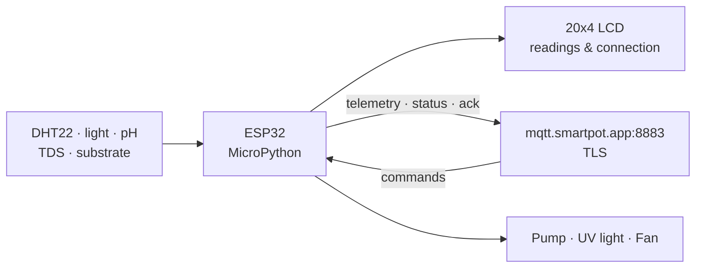
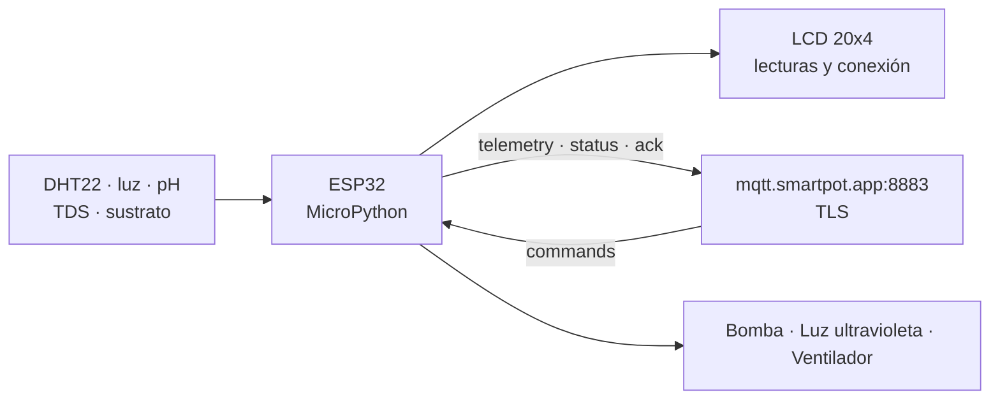

# SmartPot-IoT-Python

> **Language / Idioma:** [English](#english) | [Español](#español)

---

<a id="english"></a>

## English

### Project Status

[](https://github.com/SmartPotTech/SmartPot-IoT-Python/actions/workflows/ci.yml)
[](https://github.com/SmartPotTech/SmartPot-IoT-Python/actions/workflows/codeql.yml)

### Description

SmartPot-IoT-Python is the **MicroPython firmware companion for rapid prototyping and simulation**: MicroPython 1.24.1 on an ESP32 (supported since 1.22), simulated in [Wokwi](https://wokwi.com/projects/408863167711709185) or flashed onto a physical board. For production physical deployments, see the canonical [SmartPot-IoT](https://github.com/SmartPotTech/SmartPot-IoT) Rust `no_std` firmware. It reads sensors, displays values on an LCD screen, publishes telemetry over **MQTT over TLS**, and executes commands arriving from SmartPot while acknowledging each one. If the network drops, it continues measuring, displaying, and turning off active actuators on schedule.

With a physical board or Wokwi, the crop is **real** to SmartPot: its readings come from this firmware and train continuous learning. No hardware or Wokwi open? Create a **virtual crop** in the PWA—it is simulated by [SmartPot-DataGenerator](https://github.com/SmartPotTech/SmartPot-DataGenerator) using the same contract and cannot be converted into a real crop later.



### Circuit

| Component | ESP32 Pin | Reported Scale |
| --- | --- | --- |
| DHT22 (air temperature and humidity) | GPIO 15 | °C and % |
| Light sensor (potentiometer in Wokwi) | GPIO 34 | 0–2000 lux |
| pH sensor | GPIO 35 | 0–14 |
| TDS sensor | GPIO 32 | 0–3000 ppm |
| Substrate moisture | GPIO 33 | 0–100 % |
| Water pump (blue LED) | GPIO 19 | `WATER_PUMP` |
| UV light (purple LED) | GPIO 18 | `UV_LIGHT` |
| Fan (orange LED) | GPIO 5 | `FAN` |
| 20x4 I2C LCD | SCL 16 · SDA 17 | — |

### Project Structure

```text
SmartPot-IoT/
├── fs/                      # ESP32 filesystem
│   ├── main.py              # Boot: welcome screen, WiFi, NTP clock, and device loop
│   ├── device.py            # Loop: measures and turns off on schedule; publishes and obeys when online
│   ├── smartpot_client.py   # MQTT v1 contract and TLS verified with the CA in config.json
│   ├── sensors.py           # Analog sensors and DHT22
│   ├── actuators.py         # Actuators with timed automatic shutoff
│   ├── display.py           # LCD display: readings, actuators, and connection state
│   ├── utils.py             # NTP clock sync and console table with reading timestamp
│   ├── settings.py          # Loads config.json (shared format with the Rust firmware; config.py as fallback)
│   ├── config.example.json  # Template for config.json (untracked) with embedded broker CA
│   └── i2c_lcd.py, lcd_api.py
├── tests/                   # CPython tests with simulated MicroPython modules
├── diagram.json             # Wokwi circuit with MicroPython 1.24.1
├── wokwi.toml               # Local simulation with ESP32_GENERIC-20241129-v1.24.1.bin
├── start.py                 # Runs the firmware in local simulation via mpremote
└── pyproject.toml / uv.lock # Development tooling (mpremote, pytest, ruff)
```

### MQTT Contract

The device connects to `mqtt.smartpot.app:8883` over TLS (1.2 or newer), verifies the broker certificate with SmartPot's public CA, and authenticates with **username = crop ID** and **password = device key**. The client ID is `smartpot-<cropId>` (the broker rejects empty IDs).

| Topic | Direction | Example |
| --- | --- | --- |
| `smartpot/v1/{cropId}/telemetry` | Publishes every 30 s | `{"temperature":23.5,"humidity":61,"brightness":820,"ph":6.12,"tds":790,"soilMoisture":64.2}` |
| `smartpot/v1/{cropId}/commands` | Subscribes (QoS 1) | `{"id":"…","actuator":"WATER_PUMP","action":"ACTIVATE","durationSeconds":15}` |
| `smartpot/v1/{cropId}/commands/ack` | Publishes (QoS 1) | `{"id":"…","status":"EXECUTED","message":"Water pump turned on for 15 s"}` |
| `smartpot/v1/{cropId}/status` | Retained & Last Will | `online` / `offline` |
| `smartpot/v1/{cropId}/capabilities` | Publishes after `online` (retained, QoS 1) | `{"schema":1,"device":{"firmware":"smartpot-iot-python/2.0.0","hardware":"esp32-devkit-c-v4","telemetry":{"formats":["json-v1"]}},"sensors":[…],"actuators":["WATER_PUMP","UV_LIGHT","FAN"]}` |

With `durationSeconds`, the actuator turns off automatically once the timer expires; without it, it stays on until receiving `DEACTIVATE`.

The device declares its six sensors and three actuators in `.../capabilities` after `status=online` and before subscribing to `commands`; the message is retained, uses schema 1, does not declare `atmosphere` or `compact-v2`, and stays under 2 KB. `brightness` and `tds` are published as JSON integers, never as `820.0` or `790.0`. Command validation is strict: `id` must be a non-empty string (null, booleans, numbers, lists and objects are rejected), `actuator` and `action` must be non-empty strings, and `durationSeconds` must be a non-negative integer or absent. Commands are deduplicated by `id` over the last 16, so a QoS 1 redelivery repeats the previous ACK without toggling the hardware again.

#### Broker CA in `config.json`

Wokwi does not support `.crt` files, so the public CA is stored as PEM text inside `config.json` (`BROKER.CA_CRT`), the only device-specific file. The firmware:

- converts it to DER, which mbedtls reads across all MicroPython builds;
- passes it to `umqtt.simple` as expected by each version: `ssl_params` with `cadata` in MicroPython 1.22 and an `SSLContext` in 1.23+ (`umqtt.simple` in 1.22 ignores `SSLContext` and encrypts without verifying);
- verifies the broker certificate and hostname after synchronizing the clock via NTP, because the ESP32 validates certificate expiration dates;
- refuses to connect without a valid CA: it never sends the device key to an unverified broker.

### Offline Operation

The loop runs every half second with or without network: it turns off timed actuators on schedule, reads sensors every `interval_seconds`, and shows them on the LCD and in the console with the reading timestamp. When connected to the broker, it also publishes telemetry and handles commands. If the connection drops, it retries the broker every 10 s and WiFi every 30 s; the top-right corner of the LCD shows an antenna when online and an `X` when offline.

### Safety and Reliability

* **Actuator safety policy** (shared with the Rust firmware and the contract fixture): `durationSeconds` must be an
  integer between 1 and 3600, otherwise the command gets a `FAILED` ACK with the reason. The water pump never runs
  without a limit: `ACTIVATE` without a duration uses 3600 s, and it switches off after 300 s without a broker session.
  The UV light and the fan keep indefinite activation. `active_low: True` supports relay boards that switch on with a
  low input; GPIO5 (fan) is a strapping pin that toggles at boot, so add a pull-down on the relay input.
* **Watchdog**: `machine.WDT` (`watchdog_seconds`, default 30; `0` disables it while debugging from the REPL) restarts
  the board if the loop hangs. Outputs are switched off first at boot and on any fatal error, which restarts the board.
* **Never blocked by the network**: ACKs are published after `check_msg` returns, the socket times out after 15 s, the
  device pings the broker every 30 s, and any client error counts as a lost connection. A hardware timer turns timed
  actuators off even while the loop waits on the network, and timers use a monotonic clock so NTP never stretches them.
* **Resilient LCD**: telemetry is published before drawing; a missing or failing LCD is replaced by a no-op and probed
  again, and only changed rows are redrawn.
* **Memory**: `gc.collect()` runs before every TLS connection, `SMARTPOT-HEAP` reports the free heap (`heap_min_free`
  prints `SMARTPOT-HEAP-LOW` below a threshold), and repeated out-of-memory connection failures restart the board.
* **Plain-text markers** for automated tests: `SMARTPOT-READY`, `WIFI-UP`, `MQTT-UP`, `MQTT-DOWN`, `ACT`, `ACK`, `LCD`,
  `HEAP` and `FATAL`.

### Installation Guide

#### 1. Create the crop in SmartPot

In [smartpot.app](https://smartpot.app), create a **real** crop and choose its vessel type (pot, NFT pipes, vertical tower, or floating raft). The application displays the device key **only once** along with the connection guide (physical ESP32 or Wokwi) and the ready-to-use `config.py` containing the WiFi network and crop ID; if you lose the key, generate a new one from the Device tab.

#### 2. Configure the firmware

```bash
cp fs/config.example.json fs/config.json
```

Fill in `WIFI`, `crop_id`, and `device_key` (the guide values) in `config.json`; the `BROKER` block already contains the broker CA. Both firmwares read the same `config.json` format, and an older `config.py` from the guide still works when no `config.json` exists. `config.json` is in `.gitignore`: never commit the device key to the repository or leave it visible in a public Wokwi project.

#### 3a. Browser Simulation

Open the Wokwi project, replace its files with those in `fs/` (including your `config.json` with the CA) and `diagram.json` (which uses MicroPython 1.24.1), and run. The `Wokwi-GUEST` network has Internet access. If your copy still uses MicroPython 1.22, the firmware also works and verifies the broker.

#### 3b. Local Simulation (VS Code or wokwi-cli)

```bash
uv sync
# start the Wokwi simulation in VS Code (uses wokwi.toml) and then:
uv run python start.py
```

`start.py` mounts the `fs` folder onto the simulated ESP32 via `mpremote` and executes `main.py`.

#### Tests

```bash
uv run ruff check .
uv run pytest
```

The suite contains 78 tests and verifies the MQTT contract against the shared v1 fixture (sensor/actuator names and the legacy `LIGHTS` alias), integer telemetry and capability declaration, strict command validation, 16-id deduplication and ACK handling, timed actuator shutoff (including offline), offline loop and retry intervals, sensor scaling, LCD display, console timestamp table, and broker verification with the DER CA under both MicroPython 1.22 and 1.23+ `umqtt.simple` signatures.

### Documentation

The firmware only speaks MQTT with the broker; everything else is decided by the platform. Component documentation is in [`docs/`](docs/SmartPot_IoT_Documentation.md) (also in [DOCX](docs/SmartPot_IoT_Documentation.docx) and [PDF](docs/SmartPot_IoT_Documentation.pdf)), with diagrams in [`docs/diagrams`](docs/diagrams). The [technical documentation](https://github.com/SmartPotTech/.github/blob/main/docs/SmartPot_Technical_Documentation.md) details the MQTT contract, TLS connection, and circuit:

- [Interactive diagrams](docs/diagrams/interactive/README.md#english): ESP32 pins and firmware modules, in English and Spanish, with links to the exact source lines
- [Complete operation](https://github.com/SmartPotTech/.github/blob/main/docs/diagrams/SmartPot_Global_02_Operation_Sequence.svg)
- [State machines](https://github.com/SmartPotTech/.github/blob/main/docs/diagrams/SmartPot_Global_05_State_Machines.svg)
- [Complete architecture](https://github.com/SmartPotTech/.github/blob/main/docs/diagrams/SmartPot_Global_01_Architecture.svg)

### License

This project is licensed under the MIT License.

---

<a id="español"></a>

## Español

### Estado del Proyecto

[](https://github.com/SmartPotTech/SmartPot-IoT-Python/actions/workflows/ci.yml)
[](https://github.com/SmartPotTech/SmartPot-IoT-Python/actions/workflows/codeql.yml)

### Descripción

SmartPot-IoT-Python es el **firmware compañero en MicroPython para prototipado rápido y simulación**: MicroPython 1.24.1 sobre un ESP32 (funciona desde 1.22), simulado en [Wokwi](https://wokwi.com/projects/408863167711709185) o grabado en una placa física. Para despliegues físicos en producción, consulta el firmware canónico en Rust `no_std` [SmartPot-IoT](https://github.com/SmartPotTech/SmartPot-IoT). Lee los sensores, muestra los valores en una pantalla LCD, publica la telemetría por **MQTT sobre TLS** y ejecuta los comandos que llegan desde SmartPot, confirmando cada uno. Si se cae la red, sigue midiendo, mostrando y apagando a tiempo lo que esté encendido.

Con placa o en Wokwi, el cultivo es **real** para SmartPot: sus lecturas vienen de este firmware y entrenan el aprendizaje continuo. ¿Sin hardware ni Wokwi abierto? Crea en la PWA un **cultivo virtual**: lo simula [SmartPot-DataGenerator](https://github.com/SmartPotTech/SmartPot-DataGenerator) con el mismo contrato, y no se puede convertir en real después.



### Circuito

| Componente | Pin ESP32 | Escala enviada |
| --- | --- | --- |
| DHT22 (temperatura y humedad del aire) | GPIO 15 | °C y % |
| Sensor de luz (potenciómetro en Wokwi) | GPIO 34 | 0–2000 lux |
| Sensor de pH | GPIO 35 | 0–14 |
| Sensor de TDS | GPIO 32 | 0–3000 ppm |
| Humedad del sustrato | GPIO 33 | 0–100 % |
| Bomba de agua (LED azul) | GPIO 19 | `WATER_PUMP` |
| Luz ultravioleta (LED morado) | GPIO 18 | `UV_LIGHT` |
| Ventilador (LED naranja) | GPIO 5 | `FAN` |
| LCD 20x4 I2C | SCL 16 · SDA 17 | — |

### Estructura del Proyecto

```text
SmartPot-IoT/
├── fs/                      # Sistema de archivos del ESP32
│   ├── main.py              # Arranque: bienvenida, WiFi, hora y el ciclo del dispositivo
│   ├── device.py            # Ciclo: mide y apaga a tiempo siempre; publica y obedece con conexión
│   ├── smartpot_client.py   # Contrato MQTT v1 y TLS verificado con la CA de config.json
│   ├── sensors.py           # Sensores analógicos y DHT22
│   ├── actuators.py         # Actuadores con apagado automático por duración
│   ├── display.py           # Pantalla LCD: lecturas, actuadores y estado de la conexión
│   ├── utils.py             # Hora por NTP y tabla por consola con la hora de cada lectura
│   ├── settings.py          # Carga config.json (formato común con el firmware Rust; config.py como respaldo)
│   ├── config.example.json  # Plantilla de config.json (no se versiona) con la CA del broker en texto
│   └── i2c_lcd.py, lcd_api.py
├── tests/                   # Pruebas con CPython y módulos de MicroPython simulados
├── diagram.json             # Circuito de Wokwi con MicroPython 1.24.1
├── wokwi.toml               # Simulación local con ESP32_GENERIC-20241129-v1.24.1.bin
├── start.py                 # Ejecuta el firmware en la simulación local con mpremote
└── pyproject.toml / uv.lock # Herramientas de desarrollo (mpremote, pytest, ruff)
```

### Contrato MQTT

El dispositivo se conecta a `mqtt.smartpot.app:8883` con TLS (1.2 o superior), verifica el certificado del broker con la CA pública de SmartPot y se autentica con **usuario = id del cultivo** y la **clave del dispositivo**. El client id es `smartpot-<cropId>` (el broker rechaza ids vacíos).

| Tópico | Sentido | Ejemplo |
| --- | --- | --- |
| `smartpot/v1/{cropId}/telemetry` | Publica cada 30 s | `{"temperature":23.5,"humidity":61,"brightness":820,"ph":6.12,"tds":790,"soilMoisture":64.2}` |
| `smartpot/v1/{cropId}/commands` | Recibe (QoS 1) | `{"id":"…","actuator":"WATER_PUMP","action":"ACTIVATE","durationSeconds":15}` |
| `smartpot/v1/{cropId}/commands/ack` | Publica (QoS 1) | `{"id":"…","status":"EXECUTED","message":"Water pump turned on for 15 s"}` |
| `smartpot/v1/{cropId}/status` | Retenido y última voluntad | `online` / `offline` |
| `smartpot/v1/{cropId}/capabilities` | Publica tras `online` (retenido, QoS 1) | `{"schema":1,"device":{"firmware":"smartpot-iot-python/2.0.0","hardware":"esp32-devkit-c-v4","telemetry":{"formats":["json-v1"]}},"sensors":[…],"actuators":["WATER_PUMP","UV_LIGHT","FAN"]}` |

Con `durationSeconds` el actuador se apaga solo al cumplirse el tiempo; sin él queda encendido hasta recibir `DEACTIVATE`.

El dispositivo declara sus seis sensores y tres actuadores en `.../capabilities` después de `status=online` y antes de suscribirse a `commands`; el mensaje es retenido, usa el esquema 1, no declara `atmosphere` ni `compact-v2` y ocupa menos de 2 KB. `brightness` y `tds` se publican como enteros JSON, nunca como `820.0` o `790.0`. La validación de comandos es estricta: `id` debe ser una cadena no vacía (se rechazan null, booleanos, números, listas y objetos), `actuator` y `action` deben ser cadenas no vacías, y `durationSeconds` debe ser un entero no negativo o estar ausente. Los comandos se deduplican por `id` en los últimos 16, así que un reenvío QoS 1 repite el ACK anterior sin accionar el hardware otra vez.

#### La CA del broker en `config.json`

Wokwi no admite archivos `.crt`, así que la CA pública viaja como texto en `config.json` (`BROKER.CA_CRT`), el único archivo propio de cada dispositivo. El firmware:

- la convierte a DER, que mbedtls lee en cualquier compilación de MicroPython;
- se la entrega a `umqtt.simple` como lo pide cada versión: `ssl_params` con `cadata` en MicroPython 1.22 y un `SSLContext` desde 1.23 (el `umqtt.simple` de 1.22 ignora el `SSLContext` y cifra sin verificar);
- verifica el certificado y el nombre del broker, y antes sincroniza la hora por NTP, porque el ESP32 comprueba las fechas del certificado;
- sin una CA válida no se conecta: nunca entrega la clave a un broker sin verificar.

### Sin conexión

El ciclo corre cada medio segundo con o sin red: apaga a tiempo los actuadores, lee los sensores cada `interval_seconds` y los muestra en la LCD y en la consola, con la hora de la lectura. Con el broker conectado, además publica la telemetría y atiende los comandos. Si la conexión se cae, reintenta el broker cada 10 s y el WiFi cada 30 s; la esquina de la pantalla muestra una antena en línea y una equis sin conexión.

### Seguridad y fiabilidad

* **Política de actuadores** (compartida con el firmware Rust y con el fixture del contrato): `durationSeconds` debe ser
  un entero entre 1 y 3600; si no, el comando recibe un ACK `FAILED` con el motivo. La bomba de agua nunca queda encendida
  sin límite: un `ACTIVATE` sin duración usa 3600 s y se apaga tras 300 s sin sesión con el broker. La luz UV y el
  ventilador conservan el encendido indefinido. `active_low: True` admite módulos de relé que se activan con nivel bajo;
  GPIO5 (ventilador) es un pin de *strapping* que conmuta al arrancar, así que conviene un *pull-down* en la entrada del
  relé.
* **Watchdog**: `machine.WDT` (`watchdog_seconds`, 30 por defecto; `0` lo desactiva para depurar desde el REPL) reinicia
  la placa si el ciclo se bloquea. Las salidas se apagan antes que nada al arrancar y ante cualquier error fatal, que
  reinicia la placa.
* **La red nunca bloquea el ciclo**: los ACK se publican cuando `check_msg` termina, el socket tiene un tiempo límite de
  15 s, el dispositivo envía PINGREQ cada 30 s y cualquier error del cliente cuenta como conexión perdida. Un temporizador
  de hardware apaga los actuadores temporizados aunque el ciclo esté esperando a la red, y los temporizadores usan un
  reloj monótono para que NTP nunca los alargue.
* **LCD resistente**: la telemetría se publica antes de dibujar; un LCD ausente o averiado se sustituye por uno nulo y se
  vuelve a buscar, y solo se reescriben las filas que cambian.
* **Memoria**: `gc.collect()` se ejecuta antes de cada conexión TLS, `SMARTPOT-HEAP` informa del heap libre
  (`heap_min_free` imprime `SMARTPOT-HEAP-LOW` por debajo de un umbral) y los fallos de memoria repetidos al conectar
  reinician la placa.
* **Marcadores de texto** para pruebas automáticas: `SMARTPOT-READY`, `WIFI-UP`, `MQTT-UP`, `MQTT-DOWN`, `ACT`, `ACK`,
  `LCD`, `HEAP` y `FATAL`.

### Guía de Instalación

#### 1. Crear el cultivo en SmartPot

En [smartpot.app](https://smartpot.app) crea un cultivo **real** y elige su forma (maceta, tubos NFT, torre o balsa). La aplicación muestra **una sola vez** la clave del dispositivo junto con la guía de conexión (ESP32 físico o Wokwi) y el `config.py` listo, con la red WiFi y el id del cultivo; si pierdes la clave, genera una nueva desde la pestaña Dispositivo.

#### 2. Configurar el firmware

```bash
cp fs/config.example.json fs/config.json
```

Completa en `config.json` `WIFI`, `crop_id` y `device_key` (los valores de la guía); el bloque `BROKER` ya trae la CA del broker. Ambos firmwares leen el mismo formato de `config.json`, y un `config.py` antiguo de la guía sigue funcionando si no existe `config.json`. `config.json` está en `.gitignore`: nunca subas la clave al repositorio ni la dejes visible en un proyecto público de Wokwi.

#### 3a. Simulación en el navegador

Abre el proyecto de Wokwi, reemplaza sus archivos por los de `fs/` (con tu `config.json`, que ya trae la CA) y por el `diagram.json`, que usa MicroPython 1.24.1, y ejecuta. La red `Wokwi-GUEST` tiene salida a Internet. Si tu copia sigue en MicroPython 1.22, el firmware también funciona y verifica el broker.

#### 3b. Simulación local (VS Code o wokwi-cli)

```bash
uv sync
# inicia la simulación de Wokwi en VS Code (usa wokwi.toml) y luego:
uv run python start.py
```

`start.py` monta la carpeta `fs` en el ESP32 simulado con `mpremote` y ejecuta `main.py`.

#### Pruebas

```bash
uv run ruff check .
uv run pytest
```

La suite contiene 78 pruebas y verifica el contrato MQTT contra la fixture v1 compartida (nombres de sensores y actuadores y el alias heredado `LIGHTS`), la telemetría entera y la declaración de capacidades, la validación estricta de comandos, la deduplicación de los últimos 16 ids y el ACK, el apagado por tiempo de los actuadores (también sin conexión), el ciclo sin red con sus reintentos, la escala de los sensores, la pantalla, la tabla con la hora y la verificación del broker con la CA en DER, tanto con el `umqtt.simple` de MicroPython 1.22 como con el de 1.23 en adelante.

### Documentación

El firmware solo habla MQTT con el broker; todo lo demás lo decide la plataforma. Su documentación propia está en [`docs/`](docs/SmartPot_IoT_Documentation.md) (también en [DOCX](docs/SmartPot_IoT_Documentation.docx) y [PDF](docs/SmartPot_IoT_Documentation.pdf)), con sus diagramas en [`docs/diagrams`](docs/diagrams). La [documentación técnica](https://github.com/SmartPotTech/.github/blob/main/docs/SmartPot_Technical_Documentation.md) detalla el contrato MQTT, la conexión con TLS y el circuito.

- [Diagramas interactivos](docs/diagrams/interactive/README.md#español): los pines del ESP32 y los módulos del firmware, en español e inglés, con enlaces a las líneas exactas del código

### Licencia

Este proyecto está bajo la licencia MIT.
