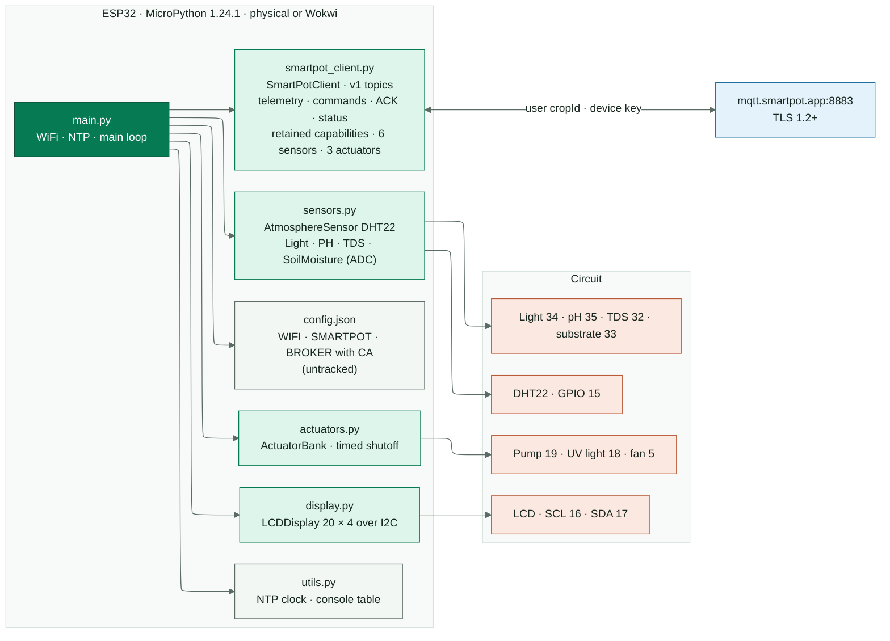
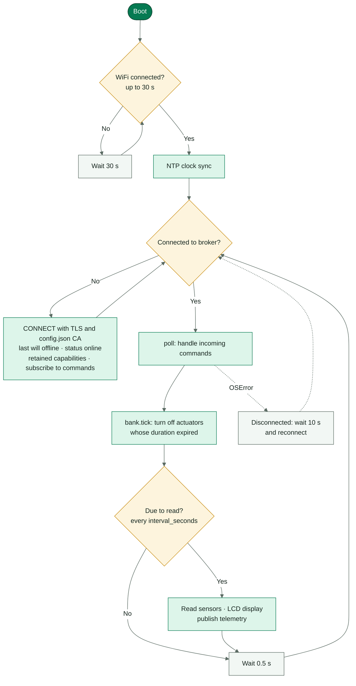
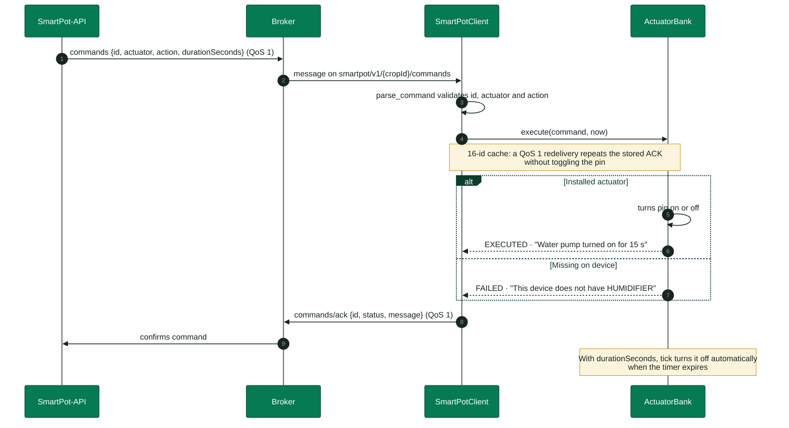

<!-- portada
eyebrow: Component Documentation · Documentación del componente
titulo: SmartPot-IoT-Python
acento: IoT
subtitulo: Real Crop Firmware · El firmware de un cultivo real
bajada: MicroPython on ESP32 (physical or Wokwi): sensors, LCD, actuators, and MQTT v1 over TLS · MicroPython en un ESP32, físico o simulado en Wokwi: sensores, pantalla, actuadores y contrato MQTT v1 con TLS.
documento: SmartPot-IoT-Python
version: 2.0 · November 2026 / noviembre 2026
equipo: SmartPotTech
proyecto: smartpot.app
-->

# SmartPot-IoT-Python

> **Language / Idioma:** [English](#english) | [Español](#español)

---

## English

### Document Sheet

| Field | Value |
| --- | --- |
| Project | SmartPot · [smartpot.app](https://smartpot.app) |
| Component | [SmartPot-IoT-Python](https://github.com/SmartPotTech/SmartPot-IoT-Python) |
| Version | 2.0 · November 2026 |
| Scope | Circuit, firmware modules, main loop, commands, telemetry and capabilities, secure connection, configuration, and tests |
| Platform Documentation | [Technical documentation](https://github.com/SmartPotTech/.github/blob/main/docs/SmartPot_Technical_Documentation.md), [project journey](https://github.com/SmartPotTech/.github/blob/main/docs/SmartPot_Project_Journey.md), [software lifecycle](https://github.com/SmartPotTech/.github/blob/main/docs/SmartPot_Software_Lifecycle.md), and [global diagrams](https://github.com/SmartPotTech/.github/blob/main/docs/README.md#diagramas-generales) |
| Maintenance | Generated from `docs/` in this repository using `.github/docs/tools`; updated with each component change |

<!-- parte: PART I | The Component -->

### 1. Purpose

#### In Plain Terms

SmartPot-IoT-Python is the program running on the device of a **real crop**: an ESP32 with its sensors, actuators, and LCD display. It measures, displays, publishes readings to the SmartPot broker, and executes incoming commands while acknowledging each one. It makes no autonomous agronomic decisions—the API and the platform AI decide. The same firmware runs on a physical board or in [Wokwi](https://wokwi.com/projects/408863167711709185), and in both cases the crop is real to the platform; virtual crops, by contrast, are simulated by SmartPot-DataGenerator.

### 2. Component Architecture

<!-- diagrama: SmartPot_IoT_Global_Component | titulo=SmartPot-IoT-Python por dentro | lamina=H -->

| Component | ESP32 Pin | Reported Scale |
| --- | --- | --- |
| DHT22 (air temperature and humidity) | GPIO 15 | °C and % |
| Light sensor (potentiometer in Wokwi) | GPIO 34 | 0–2000 lux |
| pH sensor | GPIO 35 | 0–14 |
| TDS sensor | GPIO 32 | 0–3000 ppm |
| Substrate moisture | GPIO 33 | 0–100 % |
| Water pump | GPIO 19 | `WATER_PUMP` |
| UV light | GPIO 18 | `UV_LIGHT` |
| Fan | GPIO 5 | `FAN` |
| 20×4 I2C LCD | SCL 16 · SDA 17 | — |

<!-- parte: PART II | Operation -->

### 3. Main Loop

<!-- diagrama: SmartPot_IoT_01_Main_Loop | titulo=Ciclo principal del firmware -->

### 4. Commands

<!-- diagrama: SmartPot_IoT_02_Command_Handling | titulo=Cómo atiende una orden -->

### 5. Telemetry, Capabilities and Command Validation

- **Telemetry**: JSON v1 with six fields (`temperature`, `humidity`, `brightness`, `ph`, `tds`, `soilMoisture`). `brightness` and `tds` are integers; `ph` keeps two decimals and the rest one. Missing sensors are omitted, never sent as `null`.
- **Capabilities**: after `status=online` and before subscribing to `commands`, the client publishes a retained QoS 1 message on `.../capabilities`. It uses schema 1, declares firmware `smartpot-iot-python/2.0.0`, hardware `esp32-devkit-c-v4`, telemetry `json-v1` only, six sensors (no `atmosphere`) and three actuators (`WATER_PUMP`, `UV_LIGHT`, `FAN`). The payload stays under 2 KB; a publish failure does not block the command subscription.
- **Command ids**: `parse_command` requires `id` to be a non-empty string; null, booleans, numbers, lists and objects are rejected. `actuator` and `action` must be non-empty strings, and `durationSeconds` must be a non-negative integer or absent.
- **Deduplication**: `ActuatorBank` keeps the last 16 ids with their ACK. A QoS 1 redelivery repeats the stored ACK without toggling the pin; success and failure results are both cached.

### 6. Secure Connection

| Parameter | Value |
| --- | --- |
| Broker | `mqtt.smartpot.app:8883`, MQTT over TLS 1.2 or newer |
| Certificate | Signed by SmartPot's internal CA; verified by the firmware using the public CA embedded in `config.json` under `BROKER["CA_CRT"]` |
| Username & Key | Crop ID and device key, shown once by the PWA upon creating the real crop or rotating the key |
| Client ID | `smartpot-<cropId>` |
| Status | Retained `online` upon connecting and `offline` as Last Will |

> [!WARNING]
> **Wokwi.** Keep your copy of the project private: anyone who sees `config.json` can publish as your crop. If leaked, generate a new key from the Device tab.

<!-- parte: PART III | Configuration & Testing -->

### 7. Configuration

The PWA generates `config.json` in its connection guide, containing the WiFi network (yours or `Wokwi-GUEST`), the crop's `SMARTPOT` block, and the `BROKER` block with the broker CA. `config.json` is untracked; `config.example.json` is the template, and the Rust firmware reads the same file when it is built.

| Key | Purpose |
| --- | --- |
| `WIFI.ssid`, `WIFI.password` | Network the ESP32 connects to |
| `SMARTPOT.crop_id`, `device_key` | MQTT credentials for the real crop |
| `SMARTPOT.host`, `port`, `tls` | Broker host, port, and TLS toggle |
| `BROKER.CA_CRT` | SmartPot public CA in PEM format used by the firmware to verify the broker certificate |
| `SMARTPOT.interval_seconds` | Seconds between readings (30 by default) |

### 8. Tests

`uv run ruff check .` and `uv run pytest`: a 72-test CPython suite with simulated MicroPython modules covering the MQTT contract, integer telemetry, capabilities, strict command ids, 16-id deduplication and ACKs (with durations in seconds, minutes, or hours), timed actuator shutoff, sensor scaling, broker verification with the template CA, and TLS fallback for older MicroPython versions.

### 9. Getting Started

| Environment | Steps |
| --- | --- |
| Physical board | Wire the circuit, flash MicroPython 1.24.1 (1.22+ works), copy `fs/` with `mpremote`, add your `config.json` (includes the CA), and power on |
| Wokwi in browser | Open the project, create `config.json` with the guide's block, and run; the `Wokwi-GUEST` network has Internet access |
| Local Wokwi | `uv sync`, start the simulation with `wokwi.toml`, and run `uv run python start.py` |

---

## Español

### Ficha del documento

| Campo | Valor |
| --- | --- |
| Proyecto | SmartPot · [smartpot.app](https://smartpot.app) |
| Componente | [SmartPot-IoT-Python](https://github.com/SmartPotTech/SmartPot-IoT-Python) |
| Versión | 2.0 · noviembre 2026 |
| Alcance | Circuito, módulos del firmware, ciclo principal, comandos, telemetría y capacidades, conexión segura, configuración y pruebas |
| Documentación de la plataforma | [Documentación técnica](https://github.com/SmartPotTech/.github/blob/main/docs/SmartPot_Technical_Documentation.md), [recorrido del proyecto](https://github.com/SmartPotTech/.github/blob/main/docs/SmartPot_Project_Journey.md), [ciclo de vida](https://github.com/SmartPotTech/.github/blob/main/docs/SmartPot_Software_Lifecycle.md) y [diagramas generales](https://github.com/SmartPotTech/.github/blob/main/docs/README.md#diagramas-generales) |
| Mantenimiento | Se genera desde `docs/` de este repositorio con las herramientas de `.github/docs/tools`; se actualiza con cada cambio del componente |

<!-- parte: PARTE I | El componente -->

### 1. Propósito

#### En palabras simples

SmartPot-IoT-Python es el programa que corre en el dispositivo de un **cultivo real**: un ESP32 con sus sensores, sus actuadores y una pantalla. Mide, muestra, publica las lecturas en el broker de SmartPot y obedece las órdenes que llegan, confirmando cada una. No decide nada por su cuenta: la API y la IA de la plataforma deciden. El mismo firmware corre en una placa física o en [Wokwi](https://wokwi.com/projects/408863167711709185), y en los dos casos el cultivo es real para la plataforma; los cultivos virtuales, en cambio, los simula SmartPot-DataGenerator.

### 2. Arquitectura del componente

| Componente | Pin ESP32 | Escala enviada |
| --- | --- | --- |
| DHT22 (temperatura y humedad del aire) | GPIO 15 | °C y % |
| Sensor de luz (potenciómetro en Wokwi) | GPIO 34 | 0–2000 lux |
| Sensor de pH | GPIO 35 | 0–14 |
| Sensor de TDS | GPIO 32 | 0–3000 ppm |
| Humedad del sustrato | GPIO 33 | 0–100 % |
| Bomba de agua | GPIO 19 | `WATER_PUMP` |
| Luz ultravioleta | GPIO 18 | `UV_LIGHT` |
| Ventilador | GPIO 5 | `FAN` |
| LCD 20×4 I2C | SCL 16 · SDA 17 | — |

<!-- parte: PARTE II | Funcionamiento -->

### 3. Ciclo principal

El ciclo se ejecuta cada 0,5 segundos con o sin red: apaga los actuadores cuya duración venció, lee sensores cada `interval_seconds`, actualiza la pantalla LCD y, cuando está conectado al broker, publica telemetría y atiende comandos.

### 4. Comandos

Recibe comandos JSON en `smartpot/v1/{cropId}/commands`, acciona los pines correspondientes en `ActuatorBank` y responde en `smartpot/v1/{cropId}/commands/ack` con estado `EXECUTED` o `FAILED` y mensaje en inglés.

### 5. Telemetría, capacidades y validación de comandos

- **Telemetría**: JSON v1 con seis campos (`temperature`, `humidity`, `brightness`, `ph`, `tds`, `soilMoisture`). `brightness` y `tds` son enteros; `ph` conserva dos decimales y el resto uno. Los sensores ausentes se omiten, nunca se envían como `null`.
- **Capacidades**: después de `status=online` y antes de suscribirse a `commands`, el cliente publica un mensaje retenido QoS 1 en `.../capabilities`. Usa el esquema 1, declara el firmware `smartpot-iot-python/2.0.0`, el hardware `esp32-devkit-c-v4`, telemetría solo `json-v1`, seis sensores (sin `atmosphere`) y tres actuadores (`WATER_PUMP`, `UV_LIGHT`, `FAN`). La carga ocupa menos de 2 KB; un fallo al publicar no bloquea la suscripción a comandos.
- **Ids de comando**: `parse_command` exige que `id` sea una cadena no vacía; se rechazan null, booleanos, números, listas y objetos. `actuator` y `action` deben ser cadenas no vacías, y `durationSeconds` debe ser un entero no negativo o estar ausente.
- **Deduplicación**: `ActuatorBank` guarda los últimos 16 ids con su ACK. Una reentrega QoS 1 repite el ACK guardado sin accionar el pin; se cachean tanto los éxitos como los fallos.

### 6. Conexión segura

| Parámetro | Valor |
| --- | --- |
| Broker | `mqtt.smartpot.app:8883`, MQTT sobre TLS 1.2 o superior |
| Certificado | Firmado por la CA propia de SmartPot; el firmware lo verifica con la CA pública que trae `config.json` en `BROKER["CA_CRT"]` |
| Usuario y clave | El id del cultivo y la clave del dispositivo, que la PWA muestra una sola vez al crear el cultivo real o al rotarla |
| Client id | `smartpot-<cropId>` |
| Estado | `online` retenido al conectar y `offline` como última voluntad |

> [!WARNING]
> **Wokwi.** Deja tu copia del proyecto como privada: quien vea `config.json` puede publicar como tu cultivo. Si se filtra, genera una nueva clave desde la pestaña Dispositivo.

<!-- parte: PARTE III | Operación -->

### 7. Configuración

La PWA genera `config.json` en su guía de conexión, con la red WiFi (la tuya o `Wokwi-GUEST`), el bloque `SMARTPOT` del cultivo y el bloque `BROKER` con la CA del broker. `config.json` no se versiona; `config.example.json` es la plantilla, y el firmware Rust lee el mismo archivo al compilar.

| Clave | Uso |
| --- | --- |
| `WIFI.ssid`, `WIFI.password` | Red a la que se conecta el ESP32 |
| `SMARTPOT.crop_id`, `device_key` | Cuenta MQTT del cultivo real |
| `SMARTPOT.host`, `port`, `tls` | Broker y uso de TLS |
| `BROKER.CA_CRT` | CA pública de SmartPot en PEM; con ella el firmware verifica el certificado del broker |
| `SMARTPOT.interval_seconds` | Segundos entre lecturas (30 por defecto) |

### 8. Pruebas

`uv run ruff check .` y `uv run pytest`: una suite de 72 pruebas con CPython y módulos de MicroPython simulados sobre el contrato MQTT, la telemetría entera, las capacidades, los ids de comando estrictos, la deduplicación de los últimos 16 ids y el ACK, el apagado por tiempo de los actuadores, la escala de los sensores, la verificación del broker con la CA de la plantilla y el respaldo de TLS en versiones anteriores de MicroPython.

### 9. Puesta en marcha

| Dónde | Pasos |
| --- | --- |
| Placa física | Arma el circuito, graba MicroPython 1.24.1 (funciona desde 1.22), copia `fs/` con `mpremote`, agrega tu `config.json` (ya trae la CA) y enciende |
| Wokwi en el navegador | Abre el proyecto, crea `config.json` con el bloque de la guía y ejecuta; la red `Wokwi-GUEST` tiene salida a internet |
| Wokwi local | `uv sync`, inicia la simulación con `wokwi.toml` y ejecuta `uv run python start.py` |
