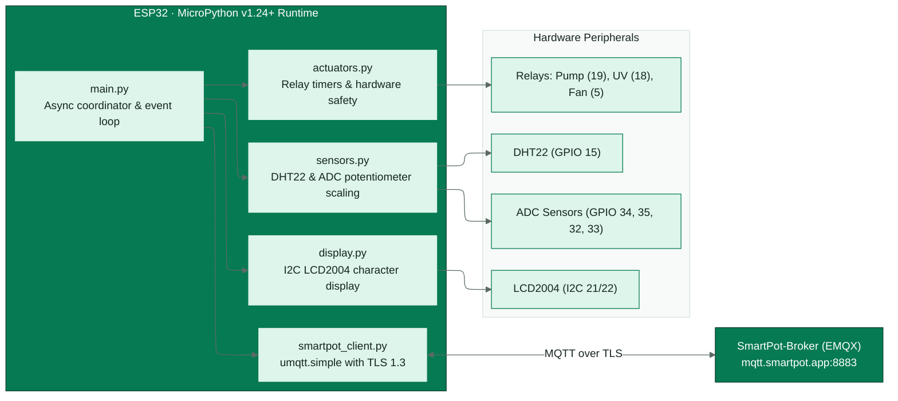
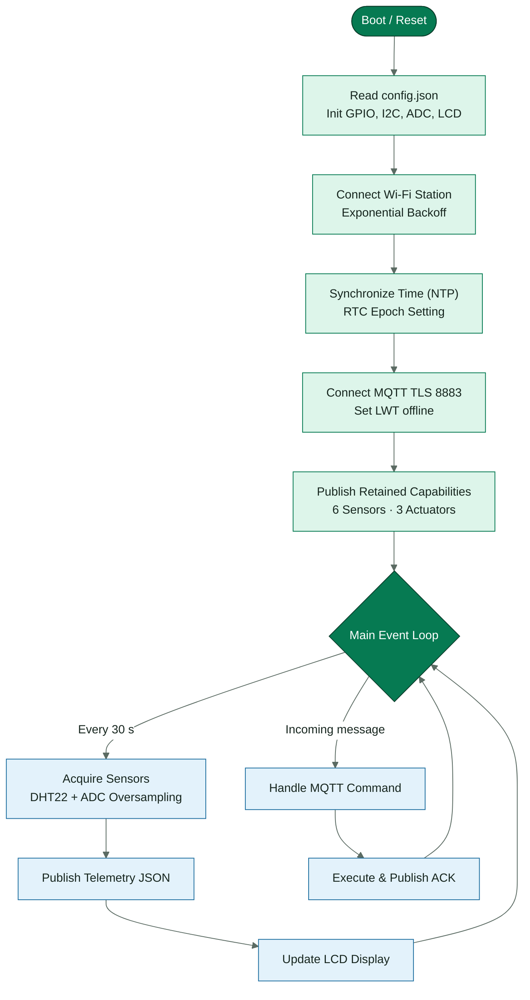
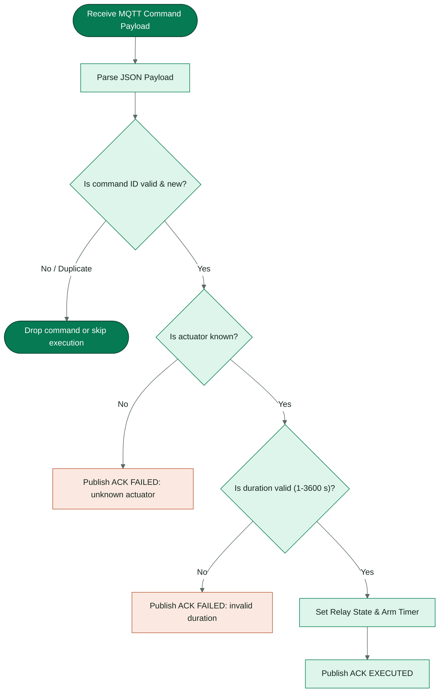

<!-- portada
eyebrow: Component Technical Documentation
titulo: SmartPot-IoT-Python
acento: IoT
subtitulo: Real Crop Firmware Engine
bajada: MicroPython firmware for ESP32 hardware and Wokwi simulation: sensor acquisition, LCD status interface, PWM actuator control, and MQTT v1 contract with TLS encryption.
documento: SmartPot-IoT-Python Documentation
version: 2.0 · November 2026
equipo: SmartPotTech
proyecto: smartpot.app
-->

# SmartPot-IoT-Python

> **Language / Idioma:** ---

### Document Sheet

| Field | Value |
| --- | --- |
| Project | SmartPot · [smartpot.app](https://smartpot.app) |
| Component | [SmartPot-IoT-Python](https://github.com/SmartPotTech/SmartPot-IoT-Python) |
| Version | 2.0 · November 2026 |
| Scope | Circuit, firmware modules, main loop, commands, telemetry and capabilities, secure connection, configuration, and tests |
| Platform Documentation | [Technical documentation](https://github.com/SmartPotTech/.github/blob/main/docs/SmartPot_Technical_Documentation.md), [project journey](https://github.com/SmartPotTech/.github/blob/main/docs/SmartPot_Project_Journey.md), [software lifecycle](https://github.com/SmartPotTech/.github/blob/main/docs/SmartPot_Software_Lifecycle.md), and [global diagrams](https://github.com/SmartPotTech/.github/blob/main/docs/README.md#diagramas-generales) |
| Maintenance | Generated from `docs/` in this repository using `.github/docs/tools`; updated with each component change |

<!-- parte: PART I | The Component -->

### 1. Purpose

#### In Plain Terms

SmartPot-IoT-Python is the program running on the device of a **real crop**: an ESP32 with its sensors, actuators, and LCD display. It measures, displays, publishes readings to the SmartPot broker, and executes incoming commands while acknowledging each one. It makes no autonomous agronomic decisions—the API and the platform AI decide. The same firmware runs on a physical board or in [Wokwi](https://wokwi.com/projects/408863167711709185), and in both cases the crop is real to the platform; virtual crops, by contrast, are simulated by SmartPot-DataGenerator.

### 2. Component Architecture

<!-- diagrama: SmartPot_IoT_Global_Component | titulo=SmartPot-IoT-Python por dentro | lamina=H -->

| Component | ESP32 Pin | Reported Scale |
| --- | --- | --- |
| DHT22 (air temperature and humidity) | GPIO 15 | °C and % |
| Light sensor (potentiometer in Wokwi) | GPIO 34 | 0–2000 lux |
| pH sensor | GPIO 35 | 0–14 |
| TDS sensor | GPIO 32 | 0–3000 ppm |
| Substrate moisture | GPIO 33 | 0–100 % |
| Water pump | GPIO 19 | `WATER_PUMP` |
| UV light | GPIO 18 | `UV_LIGHT` |
| Fan | GPIO 5 | `FAN` |
| 20×4 I2C LCD | SCL 16 · SDA 17 | — |

<!-- parte: PART II | Operation -->

### 3. Main Loop

<!-- diagrama: SmartPot_IoT_01_Main_Loop | titulo=Ciclo principal del firmware -->

### 4. Commands

<!-- diagrama: SmartPot_IoT_02_Command_Handling | titulo=Cómo atiende una orden -->

### 5. Telemetry, Capabilities and Command Validation

- **Telemetry**: JSON v1 with six fields (`temperature`, `humidity`, `brightness`, `ph`, `tds`, `soilMoisture`). `brightness` and `tds` are integers; `ph` keeps two decimals and the rest one. Missing sensors are omitted, never sent as `null`.
- **Capabilities**: after `status=online` and before subscribing to `commands`, the client publishes a retained QoS 1 message on `.../capabilities`. It uses schema 1, declares firmware `smartpot-iot-python/2.0.0`, hardware `esp32-devkit-c-v4`, telemetry `json-v1` only, six sensors (no `atmosphere`) and three actuators (`WATER_PUMP`, `UV_LIGHT`, `FAN`). The payload stays under 2 KB; a publish failure does not block the command subscription.
- **Command ids**: `parse_command` requires `id` to be a non-empty string; null, booleans, numbers, lists and objects are rejected. `actuator` and `action` must be non-empty strings, and `durationSeconds` must be a non-negative integer or absent.
- **Deduplication**: `ActuatorBank` keeps the last 16 ids with their ACK. A QoS 1 redelivery repeats the stored ACK without toggling the pin; success and failure results are both cached.

### 6. Secure Connection

| Parameter | Value |
| --- | --- |
| Broker | `mqtt.smartpot.app:8883`, MQTT over TLS 1.2 or newer |
| Certificate | Signed by SmartPot's internal CA; verified by the firmware using the public CA embedded in `config.json` under `BROKER["CA_CRT"]` |
| Username & Key | Crop ID and device key, shown once by the PWA upon creating the real crop or rotating the key |
| Client ID | `smartpot-<cropId>` |
| Status | Retained `online` upon connecting and `offline` as Last Will |

> [!WARNING]
> **Wokwi.** Keep your copy of the project private: anyone who sees `config.json` can publish as your crop. If leaked, generate a new key from the Device tab.

<!-- parte: PART III | Configuration & Testing -->

### 7. Configuration

The PWA generates `config.json` in its connection guide, containing the WiFi network (yours or `Wokwi-GUEST`), the crop's `SMARTPOT` block, and the `BROKER` block with the broker CA. `config.json` is untracked; `config.example.json` is the template, and the Rust firmware reads the same file when it is built.

| Key | Purpose |
| --- | --- |
| `WIFI.ssid`, `WIFI.password` | Network the ESP32 connects to |
| `SMARTPOT.crop_id`, `device_key` | MQTT credentials for the real crop |
| `SMARTPOT.host`, `port`, `tls` | Broker host, port, and TLS toggle |
| `BROKER.CA_CRT` | SmartPot public CA in PEM format used by the firmware to verify the broker certificate |
| `SMARTPOT.interval_seconds` | Seconds between readings (30 by default) |

### 8. Tests

`uv run ruff check .` and `uv run pytest`: a 135-test CPython suite with simulated MicroPython modules covering the MQTT contract, integer telemetry, capabilities, strict command ids, 16-id deduplication and ACKs (with durations in seconds, minutes, or hours), timed actuator shutoff, sensor scaling, broker verification with the template CA, and TLS fallback for older MicroPython versions.

### 9. Getting Started

| Environment | Steps |
| --- | --- |
| Physical board | Wire the circuit, flash MicroPython 1.22.0 (1.23+ also works), copy `fs/` with `mpremote`, add your `config.json` (includes the CA), and power on |
| Wokwi in browser | Open the project, create `config.json` with the guide's block, and run; the `Wokwi-GUEST` network has Internet access |
| Local Wokwi | `uv sync`, copy your `config.json` into `fs/`, run `uv run python tools/build_flash.py` (MicroPython 1.22.0 with `fs/` in its LittleFS), and start the simulation: it boots straight into `main.py` |

---

