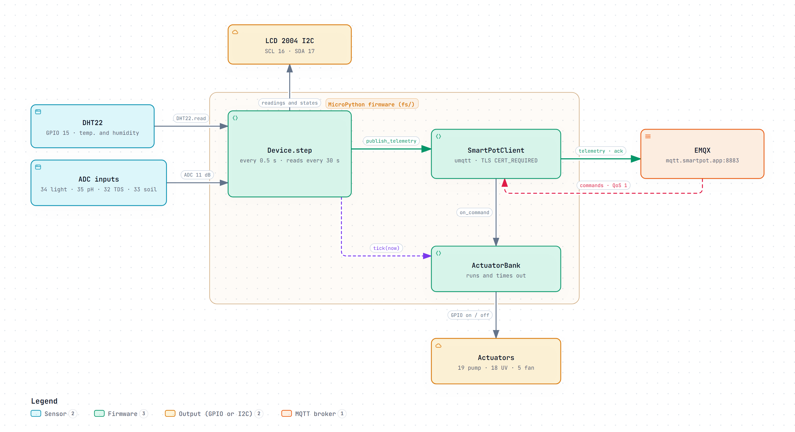
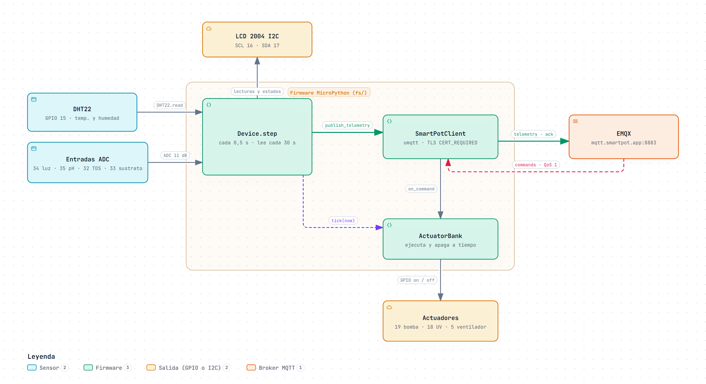

# SmartPot-IoT-Python · Interactive Diagrams

[English](#english) | [Español](#español)

---

## English

Each diagram is a self-contained HTML page that works offline. Download it and open it in a browser to zoom, search nodes, trace a path and jump to the exact source lines on GitHub. The PNG preview is the light-theme render of the same diagram.

### 1. ESP32 MicroPython: Pins and Firmware

What `main.py` wires together on the ESP32: the DHT22 on GPIO 15 and the four ADC inputs (light on 34, pH on 35, TDS on 32 and substrate moisture on 33) feed `Device.step`, which runs every half second, measures every 30 seconds and refreshes the I2C LCD 2004 on SCL 16 / SDA 17. `SmartPotClient` publishes telemetry and acknowledgements to EMQX over TLS with `CERT_REQUIRED`, and the commands it receives go to `ActuatorBank`, which drives the pump (GPIO 19), the UV light (GPIO 18) and the fan (GPIO 5) and switches timed actuators off on every tick, even offline.

- Interactive: [English](SmartPot_IoT_Python_A1_Pins_And_Firmware.en.html) · [Spanish](SmartPot_IoT_Python_A1_Pins_And_Firmware.es.html)
- Sources: `fs/main.py`, `fs/device.py`, `fs/sensors.py`, `fs/actuators.py`, `fs/smartpot_client.py`, `fs/display.py` and `fs/config.example.py` at commit `22dfacd`.

---

## Español

Cada diagrama es una página HTML autocontenida que funciona sin conexión. Descárgala y ábrela en un navegador para ampliar, buscar nodos, seguir un recorrido y saltar a las líneas exactas del código en GitHub. La vista previa PNG es el mismo diagrama en tema claro.

### 1. ESP32 MicroPython: pines y firmware

Lo que `main.py` conecta en el ESP32: el DHT22 en el GPIO 15 y las cuatro entradas ADC (luz en 34, pH en 35, TDS en 32 y humedad del sustrato en 33) alimentan `Device.step`, que corre cada medio segundo, mide cada 30 segundos y refresca la LCD 2004 I2C en SCL 16 / SDA 17. `SmartPotClient` publica la telemetría y las confirmaciones en EMQX por TLS con `CERT_REQUIRED`, y los comandos que recibe pasan a `ActuatorBank`, que maneja la bomba (GPIO 19), la luz UV (GPIO 18) y el ventilador (GPIO 5) y apaga los actuadores temporizados en cada tick, incluso sin conexión.

- Interactivo: [inglés](SmartPot_IoT_Python_A1_Pins_And_Firmware.en.html) · [español](SmartPot_IoT_Python_A1_Pins_And_Firmware.es.html)
- Fuentes: `fs/main.py`, `fs/device.py`, `fs/sensors.py`, `fs/actuators.py`, `fs/smartpot_client.py`, `fs/display.py` y `fs/config.example.py` en el commit `22dfacd`.

